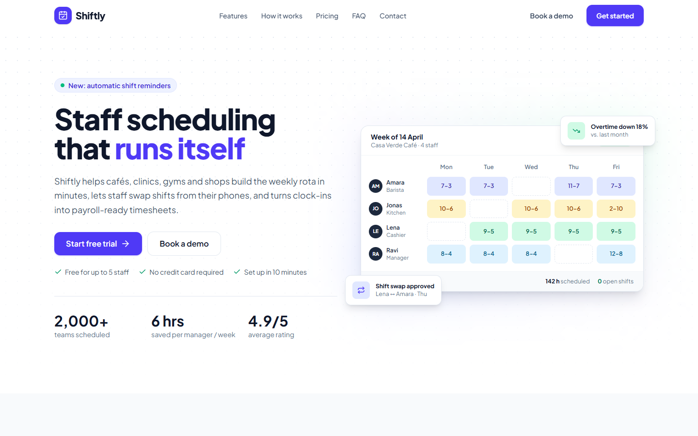
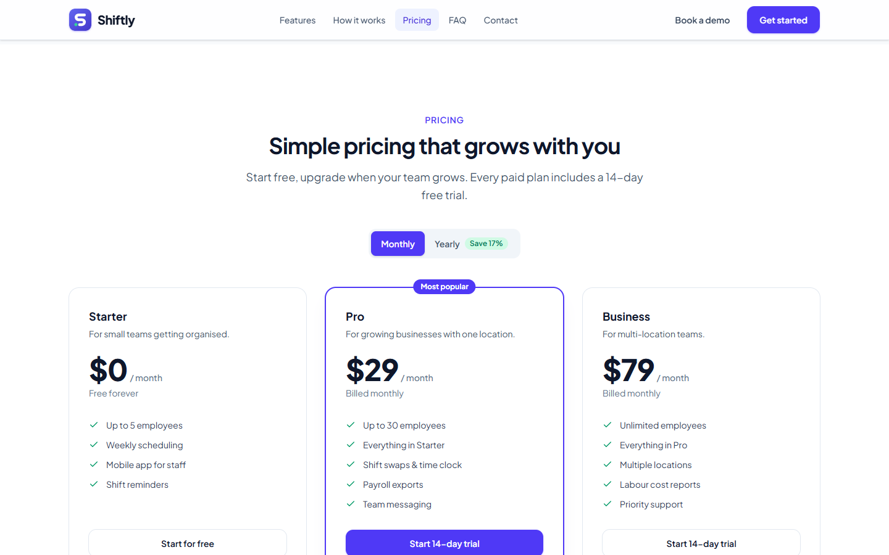
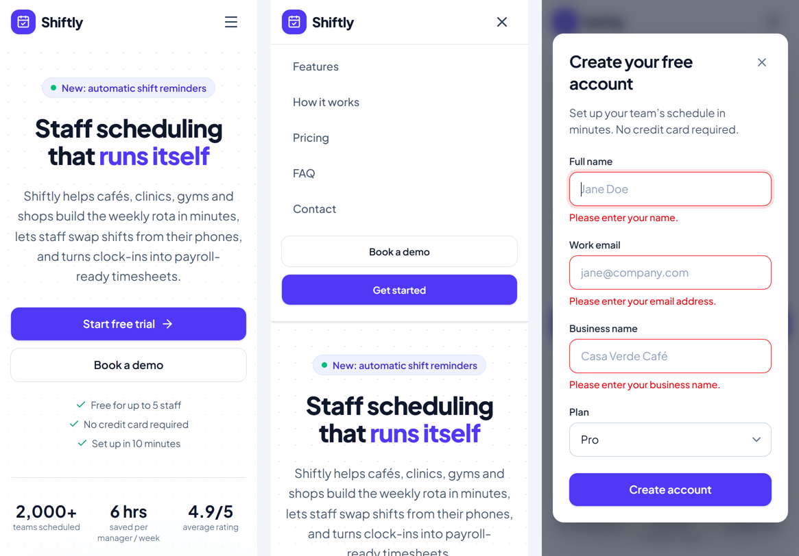

# Shiftly – SaaS Landing Page

A responsive landing page for **Shiftly**, an invented staff-scheduling SaaS for small businesses (cafés, clinics, gyms, shops). Managers build the weekly rota in minutes, staff swap shifts from their phones, and clock-ins become payroll-ready timesheets.

Built for the Sankar Group Front-End Development Internship assignment.



## Technologies

| Tool | Why |
| --- | --- |
| **React 19** | Component-based UI; each page section is its own small component |
| **Vite** | Fast dev server and production build |
| **Tailwind CSS v4** | Utility-first styling with a consistent spacing/colour scale |
| **Formik** | Form state, submit handling and the "submitting" state |
| **Yup** | Declarative validation rules (schemas) that Formik runs |
| **lucide-react** | Clean, consistent SVG icons |
| **Plus Jakarta Sans** (Google Fonts) | Friendly, modern typeface suited to SaaS products |

No backend is used. Forms validate in the browser and show a success message.

## Run it locally

Requires [Node.js](https://nodejs.org/) 20 or newer.

```bash
npm install      # install dependencies
npm run dev      # start the dev server at http://localhost:5173
```

Other scripts:

```bash
npm run build    # production build into dist/
npm run preview  # preview the production build
npm run lint     # check code with oxlint
```

## Page sections

1. **Navbar**: logo, section links (the current section is highlighted), *Book a demo* and *Get started*. Collapses into a menu on mobile.
2. **Hero**: headline, description, two calls to action, and a weekly-schedule image with two floating notification cards.
3. **Features**: six feature cards.
4. **How it works**: what the product does, plus three numbered steps.
5. **Customer stories**: three sample testimonials.
6. **Pricing**: three plans with a Monthly / Yearly toggle.
7. **FAQ**: an accordion built on native `<details>`.
8. **Contact**: contact details and a *Request a demo* form.
9. **Footer**: closing call to action, links and contact info.

## Interactions

- Nav links **smooth-scroll** to their section, offset so the sticky navbar never covers a heading.
- **Get started / Start free trial** open a sign-up dialog. Each **pricing button** opens it with that plan pre-selected.
- Both forms use **Formik + Yup validation**: required fields, a name length check and email format. Errors appear next to each field, focus moves to the first invalid field, and each error clears as soon as that field is fixed. Submitting shows a short "Sending…" state, then a success message.
- The dialog closes with the ✕ button, the **Escape** key, or a click on the backdrop.
- Content fades in on scroll. This is turned off for users who set "reduce motion".

## Project structure

```
src/
├── App.jsx                 # page layout + sign-up modal state
├── index.css               # Tailwind import, font, global base styles
├── assets/images/          # schedule image and testimonial avatars
├── data/content.js         # ALL page text (features, plans, FAQs…)
├── hooks/
│   ├── useActiveSection.js # which section is on screen (navbar highlight)
│   └── useInView.js        # scroll-reveal trigger
├── utils/
│   ├── validation.js       # Yup schemas for both forms
│   └── fakeRequest.js      # simulated network delay (no backend)
└── components/
    ├── layout/             # Navbar, Footer
    ├── sections/           # Hero, Features, HowItWorks, Pricing, …
    ├── ui/                 # Button, Modal, FormField, Reveal, … (reusable)
    └── SignupModal.jsx
brand/                      # logo files (SVG + PNG)
```

## Design choices & challenges

1. I chose indigo as the brand colour because it feels trustworthy and calm for a business tool, with emerald for success states and slate greys for readable text.
2. Every section shares one heading style and spacing scale, so the page has a clear, consistent visual hierarchy on mobile and desktop.
3. All page text lives in `data/content.js`, and sections are generated from that data, which keeps components short and easy to read.
4. All page text lives in `data/content.js`, and sections are generated from that data, which keeps components short and easy to read.
5. Forms use Formik with Yup schemas; a shared `FormField` component connects to Formik itself, so each form only lists its fields.
6. Native `<dialog>` and `<details>` elements give keyboard support and focus handling, and every field has a visible label and announced errors.
7. Challenge: showing errors when a field lost focus pushed the submit button down mid-click, so clicks missed; errors now appear on submit and clear as you type.
8. Challenge: the sticky navbar covered section headings after a link jump, which `scroll-margin-top` fixed without any JavaScript.

## Screenshots

| Desktop – pricing | Mobile – hero, menu, sign-up validation |
| --- | --- |
|  |  |

---

All names, testimonials and figures are sample content.
